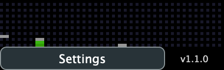

# Native UI screenshot

`assets/native-ui.png` was captured on macOS on 2026-10-27 from the actual **v1.1.0 VST3 editor**, loaded in a JUCE 8.0.9 host. It shows the plugin's default state while processing a stereo test signal at 48 kHz with a 120 BPM host transport. The host renders the native AppKit view into a PNG at the display's backing resolution (456 × 144). Controls, labels, meters and version text come from the running plugin.

- [Release v1.1.0](https://github.com/alanmarcero/winamp-classic-visualizer-vst/releases/tag/v1.1.0)
- Source commit: [`db4915d`](https://github.com/alanmarcero/winamp-classic-visualizer-vst/commit/db4915dcd8290a7b8cfd457df77f099d2a8dbffa)
- Release asset: `WinampClassicVisualizer-VST3-macOS.zip`
- Archive SHA-256, verified before capture: `114c0a4f72a7c78411f9a3bd9c2fda280534d9454972ea6cef80d5e72a26418a`
- Screenshot SHA-256: `0a670bc5cf4cbec5fe576e835c007a112fd4cdbf4332bcea1a91a2ee904dba89`
